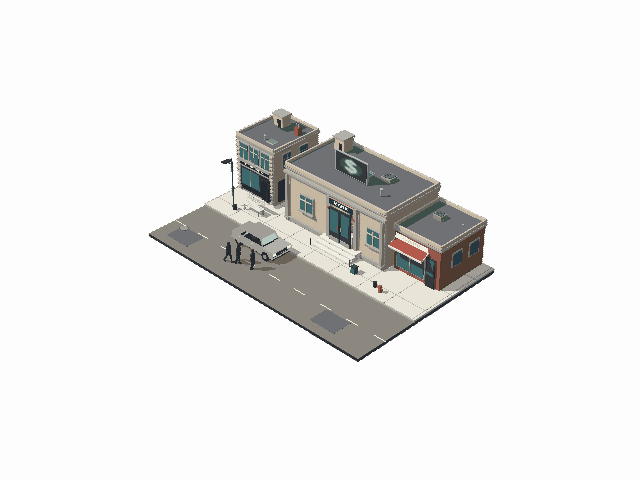
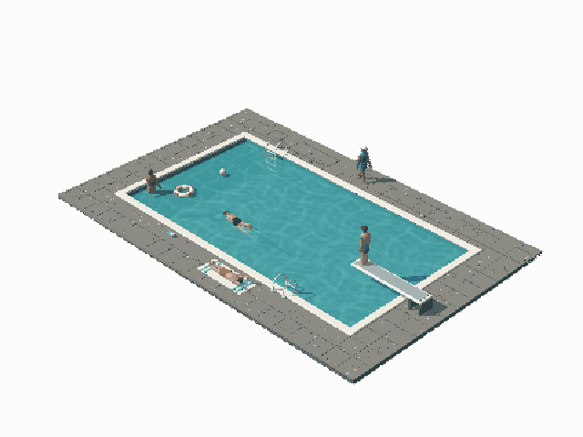
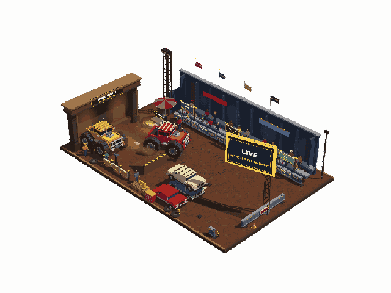
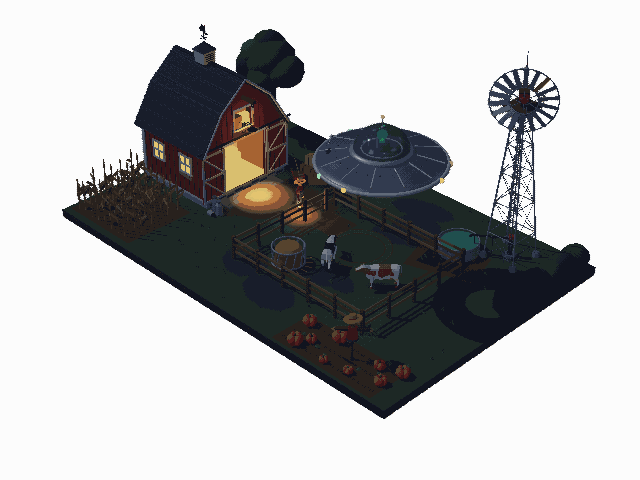
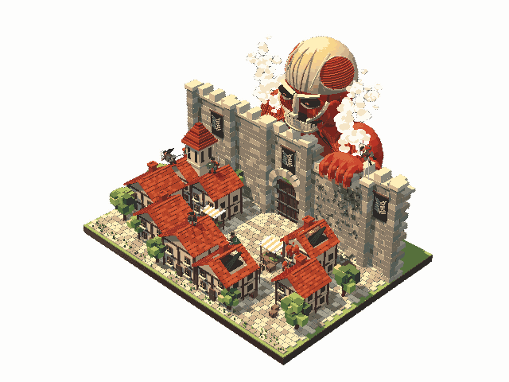

# Dioramas

A fun experiment with pixel-style Three.js scenes. Tiny worlds, playful animation, and a lot of little things happening at once.

Five miniature scenes run in real time, with chunky pixels, a fixed camera, and looping stories. Built with **Three.js + Astro**.

|                              Bank Job · The Getaway                               |                         Pool · A Slow Afternoon                         |
| :-------------------------------------------------------------------------------: | :---------------------------------------------------------------------: |
|       |  |
|                            **Dust Kings · Arena Show**                            |                **Close Encounter at Hollow Creek Farm**                 |
|  |         |

### Colossal Titan · The Breach



These are short captures of the scenes. The website renders the worlds live in your browser.

## View it locally

Use **Node.js 22.23.4 or newer** and a browser with WebGL 2 support.

```sh
git clone https://github.com/dianbrown/Dioramas.git
cd Dioramas
npm ci
npm run dev
```

Open **http://127.0.0.1:4321**. Click the side arrows or use the left/right arrow keys to explore. Browser Back and Forward remember your scene selection.

You can open a scene directly:

```text
http://127.0.0.1:4321/?scene=bank-job
http://127.0.0.1:4321/?scene=pool
http://127.0.0.1:4321/?scene=dust-kings
http://127.0.0.1:4321/?scene=ufo-farm
http://127.0.0.1:4321/?scene=titan-breach
```

Add `&t=20` to freeze a scene at a particular second. Reload without `t` to resume animation.

## Build

```sh
npm run build
npm run preview
```

The production website is written to `dist/`, ready for static hosting. Each scene also builds a self-contained HTML file at `dioramas/<scene>/<scene>.html`, which you can open directly in a browser.

## Explore the code

```text
src/                  Astro gallery, navigation, and scene registry
dioramas/
  bank-job/           City block, crew, getaway car, and bank interior
  dust-kings/         Arena, trucks, crowd, and dust effects
  pool/               Poolside world and swimming choreography
  titan-breach/       Walled town, titan, and scout animation
  ufo-farm/           Farm, animals, farmer, and UFO encounter
  shared/             Reusable geometry, characters, and build helpers
scripts/              Scene build orchestration
tests/                Browser regression checks
docs/media/           Animated scene previews
```

Each scene keeps its own stage, animation, and rendering modules. The gallery loads scenes in isolated frames and releases the previous scene when you move on.

After editing a scene while the development server is running, run `npm run scenes` and refresh the page. To add another world, create a scene folder with a `build.mjs` that produces `<scene>.html`, then register its `id` and `title` in `src/data/scenes.json`.

## Checks

```sh
npm run test:browser:install
npm test
npm run format:check
```

The browser checks cover all five scenes, deterministic seeking, valid geometry, bank door animation, gallery navigation, mobile controls, and standalone HTML loading. Test captures are saved locally in `artifacts/tests/`.
